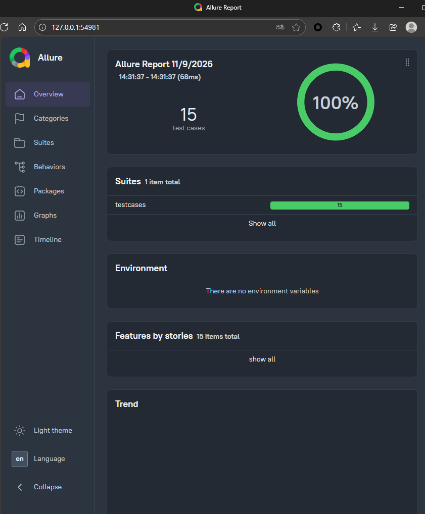
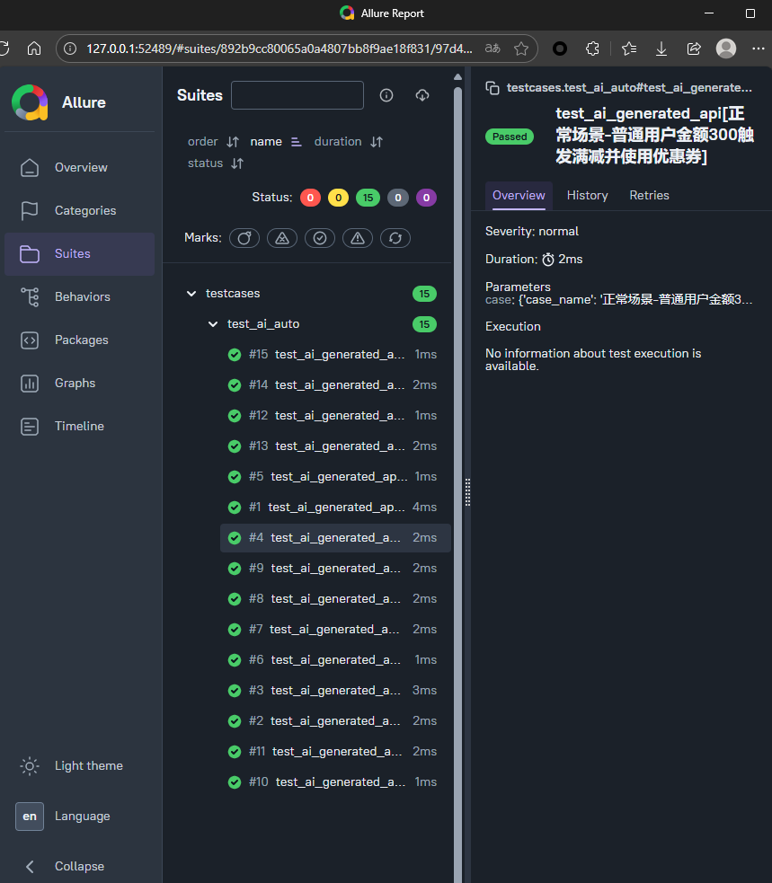
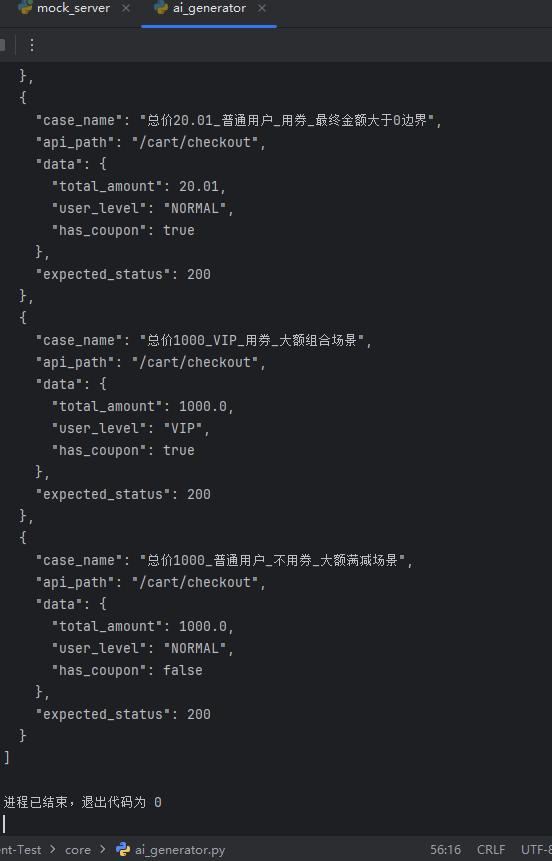
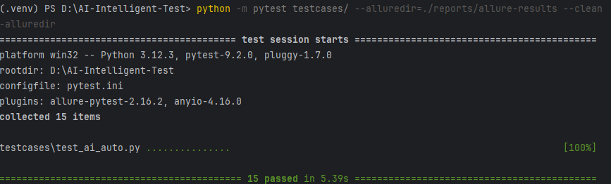

# 基于大语言模型的双十一电商结算智能测试平台

## 📖 项目简介
本项目结合 **DeepSeek 大模型 API** 与 **Python 自动化测试**，实现“接口文档解析 -> AI 自动生成复杂业务用例 -> Pytest 自动化执行 -> Allure 可视化报告”的完整 AI 赋能测试闭环。

## 🛠️ 技术栈
- **AI 大模型**：DeepSeek API (OpenAI SDK)
- **测试框架**：Pytest + Requests
- **被测服务**：Python Flask (自带异常防御机制)
- **报告引擎**：Allure

## 🎯 核心业务与测试难点
针对极具挑战的**“双十一大促阶梯结算”**业务，AI 自动生成并执行了 15+ 条高覆盖率用例：
1. **多条件组合**：满 300 减 50 + VIP 额外 9 折 + 优惠券立减 20 的叠加计算。
2. **极端边界值**：总价 299.99、300.00、300.01 的临界触发。
3. **异常流防御**：缺字段、类型错误、非法枚举值、总价<=0 的强拦截验证。

## 🔒 工程化与安全
- **隐私隔离**：采用 `python-dotenv` 动态加载 API 密钥，结合 `.gitignore` 彻底防止 Key 泄露。
- **数据驱动**：AI 输出的结构化 JSON 直接驱动 Pytest 参数化执行。

## 📊 测试成果展示

### 1. AI 生成复杂业务用例与终端执行结果

### 2. Allure 自动化测试报告总览 (100% 通过率)

### 3. Allure 测试套件详情 (覆盖多条件组合与边界值)

### 4. 测试用例参数与断言详情

## 🚀 快速开始
1. 安装依赖：`pip install -r requirements.txt`
2. 启动 Mock 服务：`python mock_server.py`
3. 执行 AI 自动测试：`pytest testcases/ --alluredir=./reports/allure-results`
4. 查看报告：`allure serve ./reports/allure-results`